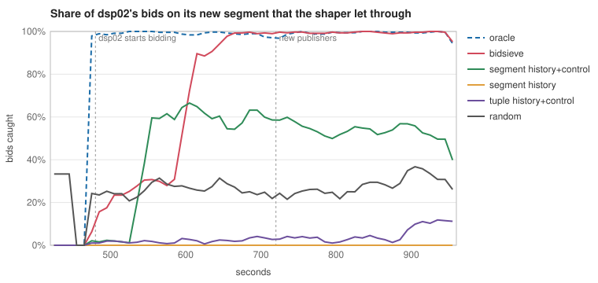
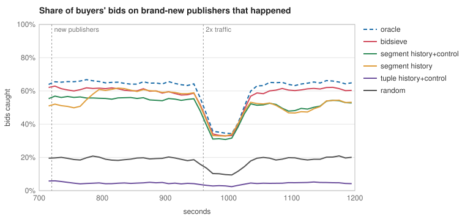

# bidsieve

Traffic shaping for ad exchanges that doesn't starve itself.

An exchange forwards bid requests to buyers (DSPs) that each take a fixed number of requests per second. Shaping picks which requests fill that budget. bidsieve does it with a model that keeps its uncertainty, lets old evidence fade, and logs a send probability with every decision, so it notices when buyers change their minds and its logs can be used to test other policies offline.

It's a Go library (`shape`), a simulated exchange to measure it in (`sim`), and a command that runs every experiment behind the numbers below.

## The problem

Ad exchanges send far more requests than buyers want. PubMatic put the scale at 50 billion impressions a day times 100 DSPs, about 5 trillion requests ([PubMatic, 2018](https://pubmatic.com/blog/bid-throttling-efficient-infrastructure/)). Rivr, a shaping vendor, says unanswered requests are over 90% of most bidstreams, and BidSwitch says a DSP may receive the same impression 20 to 50 times through different paths ([ppc.land](https://ppc.land/traffic-shaping/)). Buyers protect themselves with QPS caps, so the exchange has to choose what goes inside the cap.

Most exchanges and buyers do this from history: look at what a buyer bid on last period, keep sending what it liked, stop sending what it didn't. Amazon's donated Demand Traffic Exclusion (DTE) works this way, with tuple lists refreshed every 5 minutes and a small always-forwarded control group ([ppc.land, April 2026](https://ppc.land/amazon-gives-away-the-tool-that-fixes-programmatics-qps-waste-problem)). PubMatic started charging publishers for sending too much inventory in April 2026 ([ppc.land](https://ppc.land/pubmatic-is-now-charging-publishers-for-sending-too-much-inventory)), so the cost of waste is now on both sides.

## Why it's stuck

History-based shaping has three problems that come from the same place: it only learns from what it chose to send.

1. **It starves itself.** Once a segment is blocked, the shaper never sees the buyer's answer change. A buyer that starts a campaign on a segment it ignored last week doesn't get those requests. Control groups help a little, but a control group sized to be cheap is too thin to notice a new campaign quickly.
2. **New supply starts at zero.** A new publisher has no history, so it either gets blocked by default or gets a flat share regardless of what it is.
3. **You can't test a change safely.** If the shaper never sends some requests, the logs say nothing about them, and no offline estimate of a different policy can be trusted. The only test is live, on real revenue.

On top of that, buyers get no account of what was withheld from them, and duplicate copies of one impression eat into the same caps.

These aren't problems one exchange has. Media.net, PubMatic, Magnite, Index and every DSP on the other side run some version of this.

## The idea

Treat every (request, buyer) decision as a guess with an error bar, and send with the probability that the request is worth the buyer's budget.

- **Estimate from coarse to fine.** Counts are kept at six levels, from "everything sent to this buyer" down to the full tuple of format, country, device, channel, position and publisher. Each level borrows strength from the one above it, so a new publisher starts with its segment's numbers instead of nothing.
- **Let evidence fade.** Every count halves every two minutes. An old "no" loses weight, the error bar widens, and the segment starts being sampled again without any schedule telling it to. That is what stops the starvation loop.
- **Price each buyer's budget.** Each buyer has a price per request that moves once a second with demand against its cap. A request is worth sending when its expected bid value beats the price.
- **Send by probability, not by threshold.** A request goes with the probability that its true bid rate is above break-even, `Φ((p − λ/price) / σ)`, floored at 0.2%. Sure requests go or don't. Unsure ones near the line get sampled. Exploration ends up where it's useful instead of being a flat random share.
- **Log the probability.** Every decision returns the chance it had of going. With that, inverse propensity scoring gives honest offline estimates of other policies from the same logs.
- **Skip copies.** A short memory of which buyers each impression went to, keyed by a fingerprint of publisher, page, slot and device, plus the OpenRTB `source.tid` when it can be trusted.
- **Tell buyers what they didn't get.** A per-buyer report of what was withheld, why, and roughly what it was worth.

[DESIGN.md](DESIGN.md) goes through each step, the maths in plain words, and what breaks when you take it out.

## Results

All of this comes from a simulated exchange, described under [How it was measured](#how-it-was-measured). The full tables are in [results/](results/).

### Revenue

Standard scenario: 20 minutes, 1,500 impressions a second, 10 buyers, duplicate copies through up to four paths, a buyer changing its mind at 8 minutes, 60 new publishers at 12 minutes, and traffic doubling for a minute at 16 minutes.

| policy | revenue | of every bid buyers would make | of the oracle | copies sent to a buyer that had it |
|---|---:|---:|---:|---:|
| oracle (knows each buyer's true bid rate) | $1390 | 82.5% | 100.0% | 0.0% |
| **bidsieve** | **$1328** | **78.8%** | **95.5%** | **2.1%** |
| segment history | $819 | 48.6% | 58.9% | 45.4% |
| segment history + 5% control | $770 | 45.7% | 55.4% | 45.1% |
| tuple history + 5% control (DTE-style) | $466 | 27.7% | 33.5% | 42.3% |
| random | $309 | 18.3% | 22.2% | 10.7% |

The clairvoyant row in [compare.md](results/compare.md) knows each answer in advance and reaches 99.6%. It's there to show the ceiling, not as a target.

Part of the gap is duplicates, which the history baselines don't detect. With every impression arriving once, bidsieve gets 79.6% of the ceiling (96.1% of the oracle), segment history with control 67.6% (81.6%), and tuple history 43.3%.

Across five other worlds (seeds 100 to 104), bidsieve averages 97.0% ± 2.1 of the oracle, against 66.0% ± 8.4 for segment history with control ([seeds.md](results/seeds.md)).

### When a buyer changes its mind

At t=480s, dsp02 starts a European video campaign on a segment it ignored until then, and dsp05 ends its US and Indian mobile banner campaign.

| policy | new campaign's bids caught, first minute | minutes 1-4 | minutes 4-8 | time to 80% of oracle |
|---|---:|---:|---:|---:|
| oracle | 99.2% | 99.5% | 99.8% | 30s |
| **bidsieve** | **55.0%** | **96.3%** | **99.8%** | **80s** |
| segment history + control | 0.6% | 38.7% | 51.8% | never |
| segment history | 0.0% | 0.0% | 0.0% | never |
| tuple history + control | 0.6% | 1.6% | 3.7% | never |



Segment history learned that dsp02 doesn't want European video and never finds out otherwise. A control group lets some through, but not enough to undo the block. bidsieve's old evidence fades, its uncertainty grows, and the segment gets sampled again on its own. In the single-path scenario recovery is slower, 150s to 80% of the oracle; I haven't pinned down why.

bidsieve is slower than it should be at letting go of the campaign that ended: it still sends 105.9 requests a second to that dead segment over the next eight minutes, against 33.8 for the oracle. Fading works on both kinds of change, but a segment with a lot of history takes a while to fade. A 15s half-life cuts that to 47.5, at a cost of 1.3% of revenue ([sweep.md](results/sweep.md)).

### New publishers

| policy | bids caught on new publishers, first minute |
|---|---:|
| oracle | 62.2% |
| **bidsieve** | **60.6%** |
| segment history | 33.4% |
| segment history + control | 26.5% |
| tuple history + control | 1.0% |



A new publisher starts with its segment's estimate, so it's treated like the publishers it resembles from the first request.

### What each piece is worth

Each row turns one idea off ([ablate.md](results/ablate.md)):

| variant | revenue vs full | what broke |
|---|---:|---|
| no fading | -0.9% | European video capture in minutes 1-4 drops from 96.3% to 40.8% |
| no backoff to coarser levels | -21.6% | new publishers in the first minute drop to 33.9% |
| no IPS weights | -0.4% | almost nothing, see below |
| fixed 5% random explore instead of probability matching | -33.3% | the exploration budget goes to requests that are clearly bad |
| no duplicate detection | -17.7% | 38.8% of sends go to buyers that already had the impression |

Two of these deserve a straight answer. Fading barely moves total revenue, because the starved segment is one of many, but that is exactly how starvation hides in a dashboard. IPS weights on the coarse levels make almost no difference here; they're kept because they're cheap and make the coarse estimates mean what they say, not because this simulator shows a win.

### Duplicates

| fingerprint window | copies caught (recall) | skips that were real copies (precision) | revenue |
|---|---:|---:|---:|
| off | 0.0% | | $1093 |
| 100ms | 79.0% | 100.0% | $1259 |
| **300ms** | **98.1%** | **99.8%** | **$1328** |
| 600ms | 100.0% | 98.9% | $1331 |
| 2s | 100.0% | 94.6% | $1309 |

Longer windows catch every copy but start skipping real page reloads. 300ms is the default. 600ms is $3 better in this world, which isn't worth changing a default over.

### Offline evaluation

The model is frozen halfway through a run, and fixed rules on that frozen model are scored from the second half's logs, then compared with their true value from the world ([ope.md](results/ope.md)).

With bidsieve's logs, IPS and the doubly robust estimator land within 0.6% of the truth for the three frozen-model rules, and DR within 0.1%. Policies that send far more than the logger did, such as "send everything", come out 2.9% to 3.4% low. Naive replay overstates by up to 251.8%.

With segment history's logs, 11.0% to 78.5% of the requests a target would send could never have been sent by the logger, so IPS is off by 7.4% to 27.5%. No estimator can fix that: the data isn't there.

### Speed

On an Apple M4 ([bench.md](results/bench.md)):

| | |
|---|---:|
| decide, all 10 buyers, p50 | 2.83 µs |
| decide, p99 | 5.12 µs |
| observe one outcome | 303 ns |
| decisions per second, 1 goroutine | 307,730 |
| decisions per second, 4 goroutines | 814,976 |
| model after 10 simulated minutes | 86,158 cells, 20.5 MB |

Eight goroutines manage 729,714 decisions a second, fewer than four, because the M4's other six cores are efficiency cores.

## Using the library

```go
cfg := shape.DefaultConfig()
cfg.Buyers = []shape.Buyer{{Name: "dsp-a", QPS: 5000}, {Name: "dsp-b", QPS: 800}}
s, err := shape.New(cfg)
if err != nil {
	return err
}

// Per incoming request. FromOpenRTB turns one bid request into one
// Request per impression.
reqs, err := shape.FromOpenRTB(body, &publishers, false)
decs := make([]shape.Decision, 0, len(cfg.Buyers))
for i := range reqs {
	decs = s.Decide(&reqs[i], time.Now(), decs)
	for _, d := range decs {
		if d.Send {
			forward(d.Buyer, reqs[i], d.Prop) // keep Prop with the request
		}
	}
}

// When a buyer answers, or times out (report that as no bid):
s.Observe(shape.Outcome{Buyer: b, Features: req.Features, Prop: prop, Bid: bid, Price: cpm, At: time.Now()})
```

`Shaper` is safe for concurrent use. `Decide` doesn't allocate when `decs` has room for every buyer. Log `Decision.Prop` next to each outcome if you want to evaluate other policies offline later; the `ope` package does the estimating. `s.Report(n)` returns what each buyer had withheld and why, with the top `n` segments by estimated value.

Pass `trustTID = true` to `FromOpenRTB` only if every path to your exchange carries the same `source.tid` for the same impression. OpenRTB 2.6 says it must, but wrappers have sent each bidder a different one, so by default only the fingerprint is used.

## Running it

Go 1.24 or later. Everything runs on a laptop CPU.

```
go test -race ./...
go run ./cmd/bidsieve all -out results     # every experiment, about five minutes
go run ./cmd/bidsieve compare              # or one at a time: ablate, dedupe, ope, bench, report, seeds, sweep
go run ./cmd/bidsieve decide -buyers a:100,b:5 < cmd/bidsieve/testdata/requests.jsonl
go test -bench . ./shape
```

`decide` reads OpenRTB 2.x bid requests, one per line, and prints one JSON line per impression and buyer. The model starts empty there, so it shows cold-start behaviour and checks that real requests parse.

## Layout

```
shape/           the library: model, pacer, send rule, dedupe, reports, OpenRTB input
ope/             streaming IPS, SNIPS and doubly robust estimators
sim/             the simulated exchange, baseline policies and experiments
cmd/bidsieve/    the command behind every number in results/
internal/svg/    the line charts in results/
results/         generated output: markdown tables, CSV series, SVG charts
```
